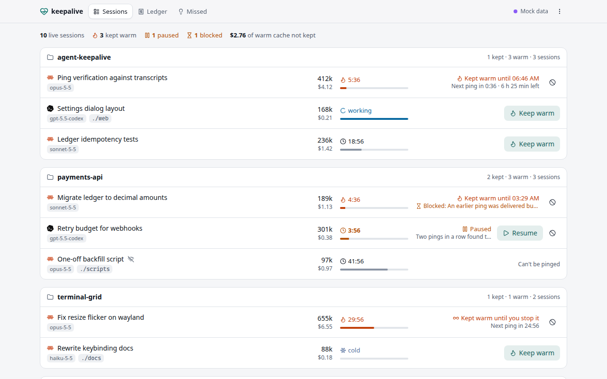

# agent-keepalive

Keeps the provider prompt cache of your Claude Code and Codex CLI sessions warm while you step away, so coming back to a long conversation reads the cache instead of paying to write it again.



## Features

- **Finds your sessions without touching them.** A local server discovers the Claude Code and Codex CLI sessions running on this machine. It only reads their session records and transcripts; it never types into a terminal.
- **Pings just in time.** For the sessions you choose, and for as long as you choose, it sends a short marked ping shortly before the cache would expire, never while the session is working. Each ping is checked against the transcript, and a ping that finds the cache cold teaches it a shorter TTL.
- **Shows what it cost and saved.** A ledger books every idle period as saved (you came back to a warm cache) or wasted (you did not), using list prices you can override.
- **One file, any OS.** Pure Go with the Vue UI embedded. Linux, macOS and Windows, amd64 and arm64.
- **Updates itself, or lets your package manager do it.** Signed apt/dnf/pacman repositories, a Homebrew tap, and self-update for the AppImage, Windows and macOS installers.
- **Usage metrics you can turn off.** Pseudonymous daily totals to a hub you can run yourself (below).

## Install

| | |
|---|---|
| Debian, Ubuntu | add the apt repository (below), then `sudo apt install agent-keepalive` |
| Fedora, RHEL, openSUSE | `sudo curl -fsSL -o /etc/yum.repos.d/agent-keepalive.repo https://agent-keepalive.gurupras.me/download/repo/agent-keepalive.repo && sudo dnf install agent-keepalive` |
| Arch Linux | see [docs/install.md](docs/install.md#arch-linux) |
| Homebrew (macOS, Linux) | `brew install gurupras/tap/agent-keepalive` |
| macOS installer | `agent-keepalive-<version>-darwin-{arm64,x64}.pkg` |
| Windows | `agent-keepalive-<version>-setup-x64.exe` (per user, no admin), or the portable `.exe` |
| Any Linux | `agent-keepalive-<version>-x86_64.AppImage` |

Everything is on the [download page](https://agent-keepalive.gurupras.me/download/) and on [GitHub Releases](https://github.com/gurupras/agent-keepalive-manager/releases). apt:

```sh
curl -fsSL https://agent-keepalive.gurupras.me/download/repo/agent-keepalive-archive-keyring.gpg \
  | sudo tee /usr/share/keyrings/agent-keepalive-archive-keyring.gpg >/dev/null
curl -fsSL https://agent-keepalive.gurupras.me/download/repo/agent-keepalive.sources \
  | sudo tee /etc/apt/sources.list.d/agent-keepalive.sources >/dev/null
sudo apt update && sudo apt install agent-keepalive
```

A `.deb`, `.rpm` or Arch package installed from the download page registers the same repository itself (opt out: [docs/package-repositories.md](docs/package-repositories.md#opting-out)). Details for every platform: [docs/install.md](docs/install.md).

## Quick start

```sh
agent-keepalive open
```

starts the server in the background if it is not running and opens the UI in your browser (the desktop entry, Start-menu shortcut and macOS app do the same). Pick a session, choose how long to keep it warm, and leave. Other commands: `serve` (foreground), `status`, `stop`, `update`, `metrics`, `version`.

On Linux, to run the server at login: `systemctl --user enable --now agent-keepalive`.

## How it works

The server binds to `127.0.0.1` only. It scans `~/.claude` and `~/.codex` (or `$CLAUDE_CONFIG_DIR`, `$CODEX_HOME`) for live sessions, tails their transcripts for API usage, and for each plan schedules a ping at TTL minus a margin after the last API call. Claude Code sessions are reached through their messaging socket and Codex sessions through `codex queue`. Every ping carries a `[keepalive id=…]` marker so it is never mistaken for a real prompt. The full design, including the scheduler's rules and the security model, is in [docs/architecture.md](docs/architecture.md); the local API is in [docs/api.md](docs/api.md).

## Privacy and usage metrics

The public build sends one report per day to the maintainer's hub at `https://agent-keepalive.gurupras.me/hub`, which exists to learn whether keeping caches warm actually helps. Its dashboard is private. A report has counts of sessions, plans and pings, the amounts saved and spent per model, the version, OS and install kind, and a random install id generated on your machine. It never sends names, paths, project names, session ids or titles, prompts or transcript content. [docs/metrics.md](docs/metrics.md) lists every field.

To opt out: Settings › Usage reports, or `agent-keepalive metrics off`, or `AGENT_KEEPALIVE_METRICS=off`. Off takes effect at once and deletes anything queued. `agent-keepalive metrics preview` prints the next report exactly as it would be sent. A build made from source without a profile reports nothing and never checks for updates.

## Building

Needs Go (see `go.mod`) and Node 24.

```sh
make ui           # build web/ and hub/web/ (embedded into the binaries)
make build        # bin/agent-keepalive: a dev build, contacts nothing
make hub          # bin/agent-keepalive-hub
make test lint
PROFILE=profiles/public.env make dist   # every package this machine can make, in dist/
```

`make dist` on Linux needs [nfpm](https://nfpm.goreleaser.com) and `makensis` (or Docker); on macOS it builds the `.pkg`. See [packaging/README.md](packaging/README.md) and [docs/releasing.md](docs/releasing.md).

## Organisation builds

Where a build reports, where it looks for updates and where its packages live all come from a **profile**, a small `KEY=value` file linked into the binary. `profiles/public.env` is the public build. An organisation copies it, points it at its own hub, download host and repository (and can make metrics mandatory or off), and builds with `PROFILE=org.env make dist`, typically from its own CI, without changing the source. Running your own hub and download host: [docs/self-hosting.md](docs/self-hosting.md).

## Contributing

See [CONTRIBUTING.md](CONTRIBUTING.md). Security issues: [SECURITY.md](SECURITY.md).

## License

Apache License 2.0. See [LICENSE](LICENSE).
